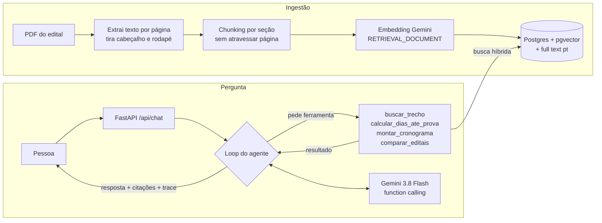
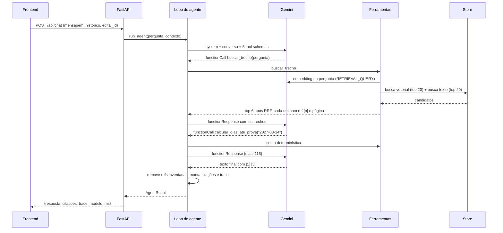

# Edital na mão

Edital de concurso tem 80, 100, 150 páginas, e a informação que você precisa sempre está num anexo lá no fim. O **Edital na mão** deixa você conversar com o edital: pergunta "quais matérias caem pra analista e quantos dias faltam pra prova?" e ele busca no PDF, faz a conta e responde **mostrando a página de onde tirou cada informação**.

É um projeto de estudo de engenharia de IA com duas peças que eu queria mostrar funcionando de verdade: **RAG** (busca em documento + LLM) e um **agente com tool calling**, os dois escritos na mão, sem LangChain, pra dar pra explicar cada linha.

> Demo: _link entra aqui depois do deploy_
>
> Os dois editais da demo são **fictícios** (gerados por script). Dá pra subir um edital real rodando localmente.

## O que ele faz

- Responde perguntas sobre um ou mais editais, sempre com citação `[1]` que abre o trecho e a página.
- Quando a pergunta pede conta (dias até a prova, divisão de horas de estudo), o agente chama uma ferramenta em vez de fazer de cabeça.
- Compara dois editais lado a lado (salário, requisitos, data da prova).
- Mostra o **caminho que o agente fez**: quais ferramentas chamou, com quais argumentos, o que voltou e quanto tempo levou.
- Quando não acha, fala que não achou. Não completa com "o que costuma ser".

## Arquitetura



### O RAG, passo a passo

1. **Extração** (`backend/app/rag/pdf.py`): texto página por página com `pypdf`. Junta palavra quebrada com hífen no fim da linha e remove cabeçalho/rodapé que se repete em quase toda página ("Página 3 de 80", nome do órgão). Sem isso, toda busca trazia o rodapé junto.
2. **Chunking** (`chunking.py`): trechos de até ~900 caracteres que **nunca atravessam página** (a citação "pág. X" tem que ser exata) e que **começam de novo a cada título de seção** ("6. DAS PROVAS", "ANEXO I"). A seção atual acompanha cada trecho. Trecho grande ganha 150 caracteres de sobreposição com o anterior.
3. **Embedding** (`llm/gemini.py`): `gemini-embedding-001` em 768 dimensões, com `taskType` diferente pra documento e pra pergunta. O texto embedado leva a seção na frente: um trecho solto "R$ 85,00" vira "3. DAS INSCRIÇÕES ... R$ 85,00", e o vetor passa a saber do que se trata.
4. **Busca híbrida** (`retrieval.py`): roda a busca vetorial (cosseno no pgvector) e a busca por texto (full text search do Postgres em português, com stemming) e junta as duas com **Reciprocal Rank Fusion**. Edital é cheio de termo exato ("R$ 85,00", "Anexo II", "nível superior") que o vetor às vezes perde, e de pergunta vaga ("quanto ganha?") que a busca por palavra perde. RRF usa só a posição em cada lista, então não precisa calibrar score de cosseno contra score de BM25.

Um detalhe que fez diferença: `plainto_tsquery` junta os termos com AND, e pergunta em linguagem natural quase nunca bate todos. Troquei por OR e deixei o `ts_rank_cd` premiar quem bate mais termos.

### O agente

O loop está em `backend/app/agent/loop.py` e cabe numa tela:

```
pergunta -> modelo -> pediu ferramenta? -> executa -> devolve o resultado -> modelo -> ... -> resposta
```

| Ferramenta | O que faz | Por que é ferramenta e não prompt |
| --- | --- | --- |
| `buscar_trecho` | Busca híbrida, devolve trechos com página e um número `ref` | Todo fato tem que vir do documento |
| `calcular_dias_ate_prova` | Dias, semanas e dias úteis até a data | LLM erra aritmética de data |
| `montar_cronograma` | Divide as horas da semana entre as matérias, proporcional ao número de questões | Conta determinística, testável |
| `comparar_editais` | Mesma busca em dois editais, lado a lado | Evita o modelo misturar as fontes |
| `listar_editais` | Quais editais estão carregados | |

Uma pergunta como "quais as matérias de específicos e quantos dias faltam pra prova?" vira, no trace: `buscar_trecho` (acha o conteúdo programático e a data) → `calcular_dias_ate_prova("2027-03-14")` → resposta com `[1]` `[2]`.

**Guarda-corpos**

- **Citação verificável**: cada trecho que volta de uma ferramenta ganha um número. O modelo cita `[n]`, e a API **apaga qualquer `[n]` que nenhuma ferramenta devolveu**. Citação inventada não chega na tela.
- **Erro de ferramenta volta pro modelo** como resultado (`{"erro": "Data inválida, use AAAA-MM-DD"}`), e ele se corrige na rodada seguinte.
- **Limite de passos** (6). Se bater, o modelo é chamado uma última vez sem ferramentas e responde com o que já tem.
- **Fallback de modelo** (`llm/fallback.py`): no tier gratuito o modelo principal às vezes responde 503 ("high demand"). Aconteceu no primeiro teste real, com todos os modelos Flash ao mesmo tempo. Agora, se o principal falha por sobrecarga, cota ou rede, a pergunta vai pro próximo da lista (`gemini-3.5-flash-lite`, depois `gemini-3.1-flash-lite`), e o que falhou fica 5 minutos de castigo pra próxima pergunta não perder tempo nele. Como o Gemini assina o raciocínio de cada turno (*thought signature*) e um modelo não aceita a assinatura de outro, o histórico que veio de outro modelo vai com a assinatura coringa que o Google documenta pra esse caso.
- **Prompt de sistema** com as regras: só afirmar o que veio da busca, tentar de novo com sinônimos do edital, dizer "não achei" quando não achar, não opinar sobre banca nem chance de aprovação.
- **Demo pública protegida**: limite por IP, upload desligado e tamanho máximo de PDF, pra cota gratuita do Gemini não estourar.

### Camada de provedor

O agente não sabe que está falando com o Gemini. Ele conversa com duas interfaces (`llm/base.py`): `ChatModel.generate(system, messages, tools)` e `Embedder.embed(texts, task)`. A implementação do Gemini usa a API REST direto com `httpx`, sem SDK, o que deixa o protocolo de function calling visível no código (inclusive o detalhe de devolver as *thought signatures* do Gemini intactas no turno seguinte). Trocar por Groq, Ollama ou Claude é escrever outra classe.

## Avaliação

Não dá pra melhorar busca no olho. `eval/perguntas.json` tem 21 perguntas escritas do jeito que gente pergunta ("quanto ganha o analista de TI?"), cada uma com o trecho que precisa aparecer ("R$ 6.850,00"). O script mede, pra cada modo de busca:

- **hit@1 / hit@5**: a página certa veio em 1º / entre os 5 primeiros?
- **MRR**: média de 1/posição do primeiro acerto.

```bash
cd backend
python -m scripts.avaliar            # com embeddings do Gemini
python -m scripts.avaliar --offline  # sem rede, embeddings por hashing
```

Resultado com `gemini-embedding-001` (768 dimensões), 21 perguntas:

| Modo | hit@1 | hit@5 | MRR |
| --- | --- | --- | --- |
| Só vetor | 90% | 100% | 0.95 |
| Só texto (BM25) | 57% | 86% | 0.70 |
| Híbrida (RRF) | 90% | 100% | 0.94 |

E com embeddings por hashing (`--offline`, que não entendem significado nenhum):

| Modo | hit@1 | hit@5 | MRR |
| --- | --- | --- | --- |
| Só vetor | 43% | 90% | 0.57 |
| Só texto (BM25) | 57% | 86% | 0.70 |
| Híbrida (RRF) | 52% | 100% | 0.72 |

O que eu tiro disso, sem enfeitar:

- Com um embedding bom, **a busca vetorial sozinha já resolve quase tudo nesse conjunto**, e a híbrida empata (MRR 0.94 contra 0.95). A busca por palavra sozinha perde feio em pergunta coloquial ("é concursado ou carteira assinada?" não tem nenhuma palavra em comum com "Consolidação das Leis do Trabalho").
- Quando o vetor é fraco (o modo offline), a híbrida é a única que acha todas no top 5. Ou seja: o RRF funciona como **seguro**. Custa uma busca por texto a mais e quase nada de qualidade quando o vetor está bom.
- Mantive a híbrida porque edital real tem muito termo exato (número de lei, código de cargo, "Anexo IV") e esse conjunto de teste é pequeno e fictício. Ainda falta provar isso com números: o próximo passo é rodar a mesma avaliação em editais reais de 100+ páginas e com perguntas de termo exato.

## Decisões

| Decisão | Por quê | O que eu abri mão |
| --- | --- | --- |
| Loop de agente próprio em vez de LangChain/LangGraph | Dá pra explicar e testar cada passo; o loop tem ~100 linhas | Streaming, memória e integrações prontas |
| Gemini (chat e embedding) | Tier gratuito sem cartão, function calling e embedding no mesmo provedor | Qualidade de tool calling um pouco abaixo dos modelos pagos |
| REST direto em vez de SDK | Protocolo visível, sem quebrar quando o SDK muda | Escrever o parse da resposta |
| Postgres + pgvector | Vetor, full text e dados no mesmo banco, numa query | Um banco vetorial dedicado escala mais |
| `MemoryStore` (numpy + BM25) além do Postgres | Roda local sem Docker nem Supabase; testes sem rede | Duas implementações pra manter (mesma interface) |
| Busca híbrida com RRF | Edital mistura termo exato e pergunta vaga | Duas buscas por pergunta |
| Ferramentas determinísticas pra conta | LLM erra data e proporção | Menos "mágica", mais código |
| Citação numerada e validada no backend | Resposta conferível; ref inventada some | O modelo precisa seguir o formato |

## Detalhes técnicos

### Stack

| Camada | Tecnologia |
| --- | --- |
| API | Python 3.11+ (Docker usa 3.12), FastAPI, Uvicorn, Pydantic Settings |
| PDF | pypdf |
| Vetores e busca | numpy (store em memória, BM25 próprio) / Postgres + pgvector (HNSW) + full text `portuguese` |
| Banco | psycopg 3 + psycopg-pool, pgvector-python |
| IA | Gemini via REST com httpx: `gemini-3.8-flash` (chat, function calling), `gemini-embedding-001` (768 dim) |
| Frontend | React 18, Vite 5, TypeScript, CSS puro (sem biblioteca de UI) |
| Testes | pytest, `httpx.MockTransport`, `fastapi.testclient` |
| Deploy | Docker multi-stage (Node builda o front, Python serve tudo), Render |

### Fluxo de uma pergunta



### Endpoints

| Método | Rota | O que faz | Erros |
| --- | --- | --- | --- |
| `GET` | `/api/health` | Banco em uso, se a IA está ligada, modelo e se aceita upload | |
| `GET` | `/api/editais` | Lista os editais carregados | |
| `POST` | `/api/editais` | Upload de PDF (`multipart`: `arquivo`, `titulo`, `fonte_url` opcional) | 403 upload desligado, 413 grande demais, 415 não é PDF, 422 PDF sem texto ou com páginas demais, 429 limite |
| `POST` | `/api/chat` | Pergunta pro agente | 404 edital inexistente, 429 limite ou cota, 502/503 Gemini fora, 503 sem chave |

Exemplo de resposta do `/api/chat` (encurtado, saída real):

```json
{
  "resposta": "A prova está marcada para o dia 14 de março de 2027 [3]. ... faltam 116 dias (ou 82 dias úteis).",
  "citacoes": [
    {
      "n": 3,
      "edital_id": "vila-serena-01-2026",
      "edital": "Prefeitura de Vila Serena 01/2026 (fictício)",
      "pagina": 2,
      "secao": "6. DAS PROVAS",
      "trecho": "6.1 A prova objetiva será aplicada no dia 14 de março de 2027, das 9h às 13h...",
      "fonte_url": null
    }
  ],
  "trace": [
    {"passo": 1, "ferramenta": "buscar_trecho", "argumentos": {"pergunta": "data da prova Analista de TI", "edital_id": "vila-serena-01-2026"}, "resumo": "6 trechos (pág. 1, 2, 3, 4)", "ms": 812, "erro": false},
    {"passo": 2, "ferramenta": "calcular_dias_ate_prova", "argumentos": {"data_prova": "2027-03-14"}, "resumo": "116 dias (16.6 semanas, 82 dias úteis)", "ms": 0, "erro": false}
  ],
  "passos": 3,
  "modelo": "gemini-3.5-flash-lite",
  "ms": 28250,
  "limite_atingido": false
}
```

A API é stateless: o histórico da conversa vai do frontend em cada pedido (últimas 8 mensagens), e as refs `[n]` de respostas antigas são tiradas do histórico porque a numeração recomeça a cada pergunta.

### Modelo de dados (Postgres)

```sql
editais (id text pk, titulo, paginas, total_trechos, fonte_url, criado_em)
trechos (
  id text pk,                -- "<edital_id>#<ordem>"
  edital_id text fk -> editais on delete cascade,
  ordem, pagina, secao, texto,
  embedding vector(768),
  tsv tsvector generated always as (to_tsvector('portuguese', secao || ' ' || texto)) stored
)
-- índices: hnsw (embedding vector_cosine_ops), gin (tsv), btree (edital_id)
```

O schema completo está em [`backend/sql/schema.sql`](backend/sql/schema.sql) e é aplicado sozinho quando a API sobe com `DATABASE_URL`. RLS fica ligado sem política: a API usa a connection string direto, e ninguém lê as tabelas pela API pública do Supabase. A conexão usa `prepare_threshold=None` porque o pooler do Supabase em modo transaction não aceita prepared statements.

### Parâmetros do RAG e do agente

| Parâmetro | Valor | Onde |
| --- | --- | --- |
| Tamanho do trecho | até ~900 caracteres | `rag/chunking.py` |
| Sobreposição | 150 caracteres | `rag/chunking.py` |
| Cabeçalho/rodapé | linha nas 2 primeiras ou 2 últimas de 60%+ das páginas | `rag/pdf.py` |
| Candidatos por busca | 20 do vetor + 20 do texto | `rag/retrieval.py` |
| Constante do RRF | 60 | `rag/retrieval.py` |
| Trechos entregues ao modelo | 6 (`SEARCH_TOP_K`) | `config.py` |
| BM25 (store em memória) | k1 = 1.5, b = 0.75 | `rag/store.py` |
| Passos do agente | 6 (`AGENT_MAX_STEPS`) | `agent/loop.py` |
| Histórico enviado | últimas 8 mensagens, até 4.000 caracteres cada | `agent/loop.py` |
| Pausa do modelo que falhou | 5 minutos | `llm/fallback.py` |

### Function calling no Gemini (o que vai no fio)

As ferramentas são declaradas em JSON Schema e convertidas pro formato que o Gemini aceita (tipos em maiúsculo):

```json
{"tools": [{"functionDeclarations": [{
  "name": "calcular_dias_ate_prova",
  "description": "Calcula quantos dias, semanas e dias úteis faltam de hoje até a data da prova.",
  "parameters": {"type": "OBJECT", "properties": {"data_prova": {"type": "STRING"}}, "required": ["data_prova"]}
}]}]}
```

O modelo devolve `{"functionCall": {"name": ..., "args": ...}}`, o loop executa e responde com um turno `user` contendo `{"functionResponse": {"name": ..., "response": {...}}}`. O turno do modelo volta inteiro no pedido seguinte, com a `thoughtSignature`, porque o Gemini 3 recusa function call sem a assinatura do próprio raciocínio.

### Testes

32 testes, todos sem rede (`cd backend && pytest`):

| Arquivo | Cobre |
| --- | --- |
| `test_rag.py` | hifenização, cabeçalho/rodapé, títulos de seção, chunking (página, seção, sobreposição), tokenização, RRF, persistência do store, busca híbrida com filtro por edital |
| `test_agent.py` | conta de dias, cronograma proporcional, resolver edital por nome, loop completo com refs inventadas removidas, erro de ferramenta, limite de passos, histórico |
| `test_gemini.py` | conversão de schema, formato de `contents`, assinatura coringa, parse de `functionCall`, embeddings em lotes de 100, 503 como erro transitório |
| `test_fallback.py` | troca de modelo, pausa e volta pro principal, erro não transitório sobe direto |
| `test_api.py` | upload + chat, PDF inválido, upload desligado, rate limit, sem chave, carga dos editais ao subir |

## Rodando localmente

Precisa de Python 3.11+ e Node 20+. Banco é opcional: sem `DATABASE_URL`, os trechos ficam num store em memória salvo em `data/store`.

```bash
git clone https://github.com/telessthalita/edital-na-mao.git
cd edital-na-mao/backend
python -m venv .venv
.venv\Scripts\activate          # no Linux/Mac: source .venv/bin/activate
pip install -r requirements-dev.txt
cp .env.example .env            # e cola a GEMINI_API_KEY
```

A chave do Gemini é grátis em https://aistudio.google.com/apikey (não pede cartão).

```bash
uvicorn app.main:app --port 8000
```

Em outro terminal:

```bash
cd frontend
npm install
npm run dev
```

Abre http://localhost:5195. Na primeira subida a API carrega os dois editais de exemplo sozinha.

### Testes

```bash
cd backend
pytest
```

Os testes não usam rede: o Gemini é trocado por um modelo com roteiro (`ScriptedChatModel`) e por embeddings de hashing. Cobrem chunking, remoção de cabeçalho, RRF, store, ferramentas, o loop do agente (incluindo ref inventada, erro de ferramenta e limite de passos), o formato das chamadas pro Gemini e a API.

### Usando Postgres (Supabase)

1. Cria um projeto no Supabase (plano gratuito já tem pgvector).
2. Copia a connection string (Project Settings > Database) pro `DATABASE_URL` no `.env`.
3. Sobe a API. O schema (`backend/sql/schema.sql`) é aplicado sozinho e os editais de exemplo são carregados.

### Variáveis de ambiente

| Variável | Pra que serve | Padrão |
| --- | --- | --- |
| `GEMINI_API_KEY` | Chave do Gemini. Sem ela a API sobe, mas chat e upload ficam desligados | vazio |
| `GEMINI_MODEL` | Modelo de chat | `gemini-3.8-flash` |
| `GEMINI_FALLBACK_MODELS` | Modelos tentados, em ordem, quando o principal está sobrecarregado. Vazio = sem fallback | `gemini-3.5-flash-lite,gemini-3.1-flash-lite` |
| `GEMINI_EMBED_MODEL` / `EMBED_DIM` | Modelo e dimensão do embedding | `gemini-embedding-001` / `768` |
| `DATABASE_URL` | Postgres com pgvector. Vazio = store em memória | vazio |
| `SEED_ON_STARTUP` | Carrega os editais de `data/editais` se o banco estiver vazio | `true` |
| `ALLOW_UPLOAD` | Libera o upload de PDF | `true` |
| `MAX_UPLOAD_MB` / `MAX_PAGES` | Limites do PDF | `15` / `200` |
| `RATE_LIMIT_CHAT_PER_HOUR` | Perguntas por IP por hora | `40` |
| `AGENT_MAX_STEPS` | Máximo de rodadas do agente | `6` |

## Deploy

Um serviço só: o `Dockerfile` builda o frontend e a API serve tudo. O `render.yaml` sobe no plano gratuito do Render com upload desligado e limite de perguntas por IP. Sem `DATABASE_URL`, os editais de exemplo são recarregados a cada vez que o serviço sobe (são poucos trechos, custa segundos).

Pra publicar:

1. Sobe o repositório pro GitHub.
2. No Render: **New > Blueprint**, escolhe o repositório. Ele lê o `render.yaml`.
3. Quando pedir, cola a `GEMINI_API_KEY`.
4. Espera o build e abre `/api/health` pra conferir (`"ia": true`).

No plano gratuito o serviço dorme depois de 15 minutos sem uso, então a primeira pergunta depois disso demora uns 50 segundos a mais.

## Estrutura

```
backend/
  app/
    agent/     loop do agente, ferramentas e prompt
    llm/       interfaces de provedor, Gemini (REST), fallback entre modelos e fakes de teste
    rag/       PDF, chunking, stores (memória e Postgres), busca híbrida
    main.py    API FastAPI
  scripts/     gerar editais de exemplo, seed, avaliação
  sql/         schema do Postgres
  tests/
frontend/      React + Vite + TypeScript
data/editais/  PDFs de exemplo e manifesto
eval/          perguntas-gabarito
docs/SPEC.md   spec escrita antes do código
```

## Próximos passos

- Avaliar em editais reais grandes e publicar a tabela com o Gemini.
- Avaliação da resposta final (não só da busca): checar se a citação sustenta a frase.
- Streaming da resposta e do trace.
- OCR pra edital escaneado.
- Reranking com cross-encoder depois do RRF.

<details>
<summary><strong>English version</strong></summary>

## Edital na mão ("the exam notice in your hand")

Brazilian public-service exam notices (*editais*) run 80 to 150 pages, and the detail you need is always buried in an annex. **Edital na mão** lets you chat with the notice: ask "which subjects are on the analyst exam and how many days until the test?" and it searches the PDF, does the math, and answers **citing the page each fact came from**.

It is an AI engineering study project built to show two things working for real: **RAG** (document retrieval + LLM) and an **agent with tool calling**, both hand-written without LangChain so every line can be explained.

The demo notices are **fictional** (generated by a script).

### Architecture

**Ingestion**: `pypdf` extracts text per page; repeated headers/footers are removed; chunks of ~900 chars never cross a page boundary (so "p. X" citations are exact) and restart at every section heading; each chunk is embedded with `gemini-embedding-001` (768 dims) with its section title prepended for context; vectors, text and a Portuguese full-text `tsvector` live in Postgres + pgvector.

**Retrieval**: hybrid search, vector (cosine) plus full text (Postgres FTS with Portuguese stemming, terms OR-ed instead of AND-ed), merged with Reciprocal Rank Fusion. Notices mix exact terms ("R$ 85,00", "Annex II") that embeddings can miss with vague questions ("how much does it pay?") that keyword search misses.

**Agent**: a ~100-line loop (`backend/app/agent/loop.py`): send conversation + tool schemas to Gemini, run the tools it asks for, feed results back, repeat until it answers or hits the step limit. Tools: `buscar_trecho` (hybrid search), `calcular_dias_ate_prova` (date math), `montar_cronograma` (study plan weighted by number of questions), `comparar_editais` (side-by-side search in two notices), `listar_editais`. Math lives in deterministic tools because LLMs get date arithmetic wrong.

**Guardrails**: every retrieved chunk gets a number and the model cites `[n]`; the API strips any `[n]` no tool returned, so fabricated citations never reach the UI. Tool errors go back to the model as results so it can self-correct. Step limit with a final no-tools call. System prompt rules: only state what retrieval returned, retry with the notice's vocabulary, say "not found" when not found. Public demo has per-IP rate limits and uploads disabled.

**Provider layer**: the agent only knows `ChatModel` and `Embedder` interfaces. The Gemini implementation calls the REST API directly with `httpx` (including passing Gemini thought signatures back untouched). Swapping to Groq, Ollama or Claude means writing another class.

### Evaluation

`eval/perguntas.json` holds 21 questions phrased the way people ask, each with the snippet that must be retrieved. `python -m scripts.avaliar` reports hit@1, hit@5 and MRR for vector-only, text-only and hybrid search. With `gemini-embedding-001`, vector-only search already gets 90% hit@1 and MRR 0.95, and hybrid ties (0.94); keyword-only lags (0.70) on colloquial questions. With weak offline hashing embeddings, hybrid is the only mode that finds every answer in the top 5. So RRF acts as insurance: almost free when embeddings are good, decisive when they are not. Proving its value on large real notices with exact-term questions is the next step.

**Model fallback**: on the free tier the primary model sometimes returns 503 "high demand" (it happened on the first real run). `FallbackChatModel` moves to the next model in the list and puts the failing one on a 5-minute cooldown. History produced by a different model is sent with Google's documented placeholder thought signature.

### Key decisions

Own agent loop over a framework (explainable, testable); Gemini for chat and embeddings (free tier, no credit card); REST over SDK; Postgres + pgvector for vectors and full text in one query; an in-memory store with the same interface so it runs locally without Docker and tests run offline; hybrid search with RRF; deterministic tools for math; numbered, backend-validated citations.

### Running locally

```bash
cd backend && python -m venv .venv && .venv\Scripts\activate
pip install -r requirements-dev.txt && cp .env.example .env   # add GEMINI_API_KEY
uvicorn app.main:app --port 8000
cd ../frontend && npm install && npm run dev                   # http://localhost:5195
```

Tests (`pytest`) run fully offline using a scripted chat model and hashing embeddings.

### Technical details

- **Stack**: Python 3.11+, FastAPI, pypdf, numpy, psycopg 3 + pgvector (HNSW) + Postgres Portuguese full text; Gemini over REST with httpx (`gemini-3.8-flash` with lite fallbacks, `gemini-embedding-001` at 768 dims); React 18 + Vite 5 + TypeScript; pytest; multi-stage Docker on Render.
- **Endpoints**: `GET /api/health`, `GET /api/editais`, `POST /api/editais` (multipart PDF upload), `POST /api/chat` (`{mensagem, historico, edital_id}` → `{resposta, citacoes, trace, passos, modelo, ms}`). The API is stateless; the client sends the last 8 messages.
- **Data model**: `editais` and `trechos` tables; `trechos` holds page, section, text, `vector(768)` and a generated `tsvector`; HNSW and GIN indexes; RLS enabled with no policies; `prepare_threshold=None` for Supabase's transaction pooler.
- **Parameters**: ~900-char chunks with 150-char overlap, 20 + 20 candidates fused with RRF (k = 60), 6 chunks to the model, BM25 k1 = 1.5 / b = 0.75, 6 agent steps, 5-minute cooldown for failing models.
- **Wire format**: tools are declared as JSON Schema and converted to Gemini's uppercase types; the model's turn is echoed back verbatim with its `thoughtSignature`, as Gemini 3 requires.
- **Tests**: 32 offline tests across RAG, agent loop, Gemini client, fallback and API.

### Deploy

Single service: the `Dockerfile` builds the frontend and the API serves it. `render.yaml` targets Render's free plan. Without `DATABASE_URL`, the sample notices are re-ingested on startup.

</details>

---

Feito por [Thalita Teles](https://telessthalita.com.br) com spec antes do código e IA como assistente.
